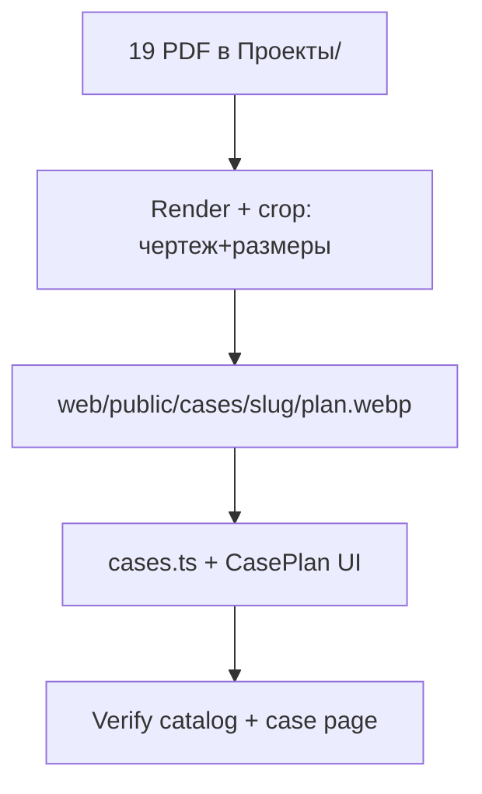

# Task canvas — plan-only cases

## Inventory (slug / title / area)

| folder | slug | title | area | complex |
|--------|------|-------|------|---------|
| ЖК Виденеевский | videneevsky | ЖК Виденеевский | — | Виденеевский |
| п Шмитдово | shmitdovo | п. Шмитдово | — | — |
| пр Дружбы народов, 50 кв м | druzhby-narodov | пр. Дружбы народов | 50 | — |
| ул Айская | ayskaya | ул. Айская | — | — |
| ул Гоголя | gogolya | ул. Гоголя | — | — |
| ул Губайдиллина | gubaydullina | ул. Губайдуллина | — | — |
| ул Губайдулина 12 | gubaydullina-12 | ул. Губайдуллина, д. 12 | — | — |
| ул Губайдуллина 10 | gubaydullina-10 | ул. Губайдуллина, д. 10 | — | — |
| ул Достовалова | dostovalova | ул. Достовалова | — | — |
| ул Комсомольская | komsomolskaya | ул. Комсомольская | — | — |
| ул Летчиков, 40 кв м | letchikov | ул. Летчиков | 40 | — |
| ул Мурзина, 35 кв м | murzina | ул. Мурзина | 35 | — |
| ул Подполковника Недошвина | nedoshvina | ул. Подполковника Недошвина | — | — |
| ул Рыльского | rylskogo | ул. Рыльского | — | — |
| ул Спатара, 58 кв м | spatara | ул. Спатара | 58 | — |
| ул Энтузиастов 7, 44 кв м | entuziastov-7 | ул. Энтузиастов | 44 | — |
| ЖК Гринвич | greenwich | ЖК Гринвич | — | Гринвич |
| ЖК Диво, 52 кв м | divo | ЖК Диво | 52 | Диво |
| ЖК Сапфир, 45 кв м | sapfir | ЖК Сапфир | 45 | Сапфир |

## Decisions

- cover/card: `#070B14` (нет фото)
- plan only → `plan: /cases/<slug>/plan.webp`
- UI: CasePlan как в Ellis
- privacy: рамка/штамп с №кв и ФИО вырезаются
